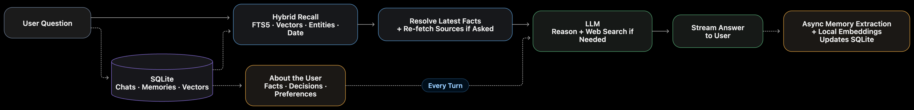

# Design

A chat agent with one tool, web search, and a memory of every past conversation.

## How it works

**1. Store.** One SQLite file holds three things:

- **The log**: every question and answer, with its time and sources.
- **About the user**: their decisions, facts and preferences. These go into every prompt.
- **Claims**: prices and versions from answers, each with its source page.

**2. Find** (`src/core/memory/context.ts`). Five searches run on each message and are merged by reciprocal rank fusion:

`keyword (FTS5)` · `meaning (local embeddings)` · `entity` · `one hop along entity links` · `date ("last Tuesday")`

**3. Decide, in code, before the model runs.**

- **What is current**: memories are never overwritten. A newer value for the same subject marks the old one `[replaced on 6 Nov]`.
- **Re-check**: asked whether facts still hold, code fetches the claims' source pages.
- **Search**: one `web_search` call carries up to 10 parallel searches, two rounds at most.

**4. Remember.** After each answer, one structured call extracts memories from the unfinished turns in the database, so a closed window loses nothing. It runs in the app's process for now, since the app is local; deployed, it would be a separate worker.

## Why this way

One rule: **whatever code can do before the model runs, code does.** The model is slow and ignores instructions, so it only compares and answers.

- **Code recalls, not the model.** About 10 ms, no model round. Told in the prompt not to search, the model still searched 3 of 3 times; code withholds the tool.
- **Log and memories, both.** Memories can be ranked and replaced; the log keeps what extraction drops. A buried detail: 0 of 8 found without the log, 8 of 8 with it.
- **Five searches, not vectors alone.** Each finds what the others miss: entity links bring in a newer price of a product the question never names, and a named day brings in that day's chats exactly.
- **The user's facts in every prompt.** Small and almost always relevant, so never searched for.
- **Never overwrite; keep the source.** Answers "what was it on 3 November?" and re-checks the same page: 8 to 10 s became 5 to 7 s.

Checked end to end on a 47-chat, 191-turn history. The live runs used memories extracted by the model, not written by hand:

| Check                                                      | Result     |
| ---------------------------------------------------------- | ---------- |
| The right context reaches the prompt (offline, runs in CI) | 159 of 159 |
| Hard questions, live, on extracted memories                | 25 of 26   |
| The brief's three sample questions, live, same history     | 3 of 3     |

Each live case ran once, on cases I wrote. The logic in `src/core` is handed its model, search and database, so tests and evals swap them for fakes.

## Considered and rejected

| Option                                     | Why not                                                          |
| ------------------------------------------ | ---------------------------------------------------------------- |
| A memory tool the model calls              | One more model round, about 2 s, on every recall question        |
| A model call to rewrite or route the query | A serial call on every turn; recall in code passes 159 of 159    |
| Vector database, embedding API             | One user's vectors compare in 1 ms; the local model needs no key |
| Overwriting a memory when a fact changes   | Loses "what was it on 3 November?"                               |

## With another week

- **A background worker that maintains memory**: re-check saved prices on a schedule, merge two names for one subject, retire memories a later chat contradicts, and summarise old chats.
- **User control**: let the user see, correct and delete what is remembered.
- **Speed**: "has it changed?" turns take 5 to 10 s to the first word.
- **Fewer word patterns**: several rules (no search, what changed, how many) match wordings; others fall back to the model.
- **A public benchmark**: run LongMemEval for a number comparable with published systems.

Experiments are recorded in `MEMORY_ARCHITECTURE.md`.
