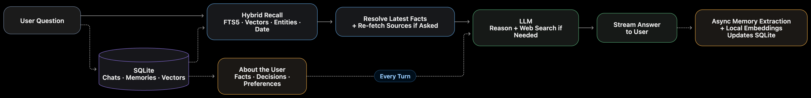

# Search Agent

A chat agent with one tool, web search, and a memory of every past conversation. Ask it what you
asked last Tuesday, and whether the answer still holds today.



## How it works

1. **Store.** One SQLite file holds the log of every chat, what is known about the user
   (decisions, facts, preferences), and claims: prices and versions, each with its source page.
2. **Find.** Five searches run in code on each message (keyword, meaning, entity, one hop along
   entity links, date) and are merged by reciprocal rank fusion. No model call.
3. **Decide.** Before the model runs, code marks which value is current and, when asked whether
   something still holds, fetches the source pages again.
4. **Answer.** The model compares, searches the web if it needs to, and streams the reply.
5. **Remember.** After the reply, one model call extracts new memories.

The reasons, the results and what was rejected are in [DESIGN.md](DESIGN.md).

## Run it

Needs Node 20.9 or newer (`nvm use` picks the version in `.nvmrc`).

```bash
npm install
cp .env.example .env   # add your OpenRouter and Tavily keys
npm run dev            # http://localhost:3000
```

To try recall without waiting a week, click **Load demo history** in the sidebar: it adds 47 past
chats, dated over the last eight weeks, with no API call. Then try:

- "On Monday we shortlisted 5 CRM tools for a 20-person sales team. Has any of them changed
  pricing or shipped something big since?"
- "Last Tuesday I asked you about Postgres hosting. Has any pricing changed since then?"
- "What did I ask you last Tuesday? Is your answer still correct today?"

The demo chats are dated back from today, so weekdays stay right whenever you load them. A fixed
date such as "3 November" matches only if a chat falls on that day.

## Import your own chats

To test with your own history, click **Import chats from a JSON file** in the sidebar and pick a
file shaped like [examples/chats.json](examples/chats.json):

```json
[
  {
    "title": "Postgres hosting",
    "date": "2026-11-03T15:15:00Z",
    "messages": [
      { "role": "user", "content": "How do Neon and Supabase compare on price?" },
      {
        "role": "assistant",
        "content": "Neon's Launch plan is $19 a month [1].",
        "sources": [{ "title": "Neon pricing", "url": "https://neon.com/pricing" }]
      }
    ]
  }
]
```

- `date` is when the chat began: a date (`2026-11-03`) or a date and time. `title` and `sources`
  are optional. Messages alternate user and assistant.
- The chats appear at once, and can be recalled by date at once. Their memories are then
  extracted by the same job that runs after a live turn: one model call per turn, 3 to 4 seconds
  each (13 turns took 44 s). The sidebar counts the turns left. Extraction also gives each chat
  a new title.
- A price is re-checked at its source later only if the answer cites it (`[1]`) and lists
  `sources`. Without them the agent still recalls the answer and searches the web.
- If extraction fails (a missing key, a spending cap), the chats are kept: run `npm run reindex`.

## Scripts

| Command             | What it does                                                                                  |
| ------------------- | --------------------------------------------------------------------------------------------- |
| `npm run dev`       | Start the app                                                                                 |
| `npm test`          | Unit tests (no API keys needed)                                                               |
| `npm run eval`      | Offline evals of memory recall (free); `-- --live <case ids>` also runs them on the real APIs |
| `npm run reindex`   | Rebuild every memory from the message log (uses the model)                                    |
| `npm run typecheck` | TypeScript check                                                                              |
| `npm run lint`      | Biome lint and format check                                                                   |
